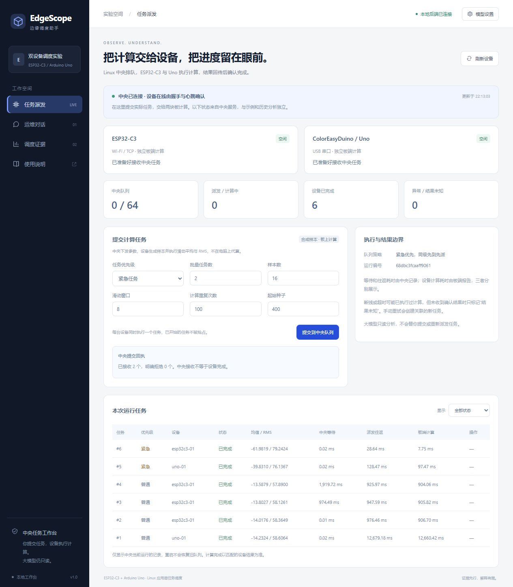
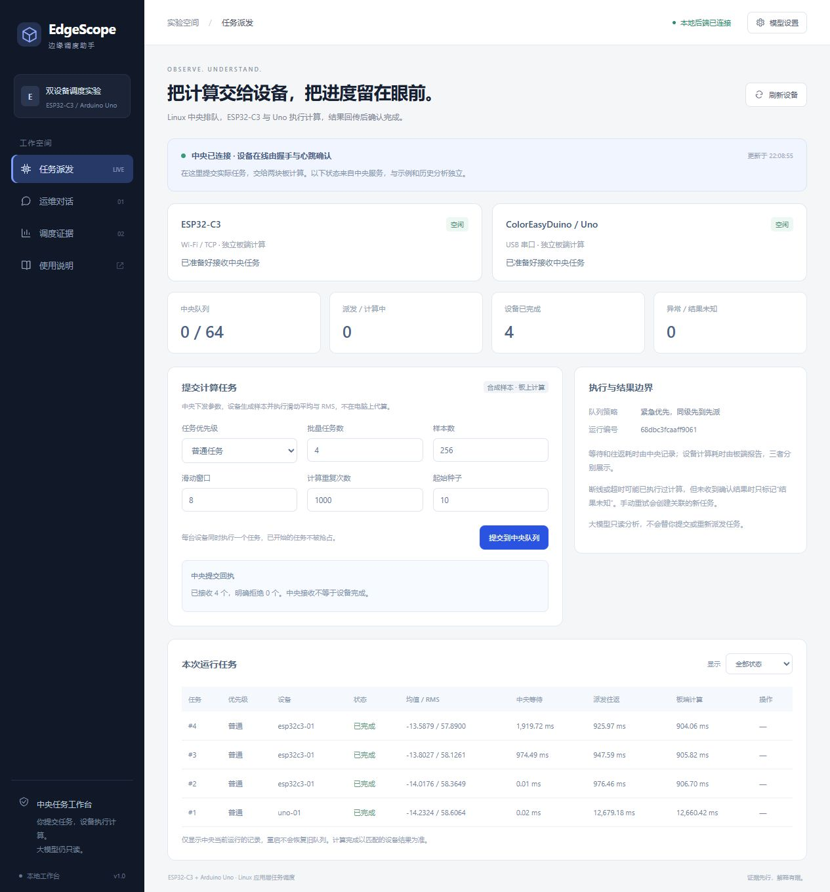
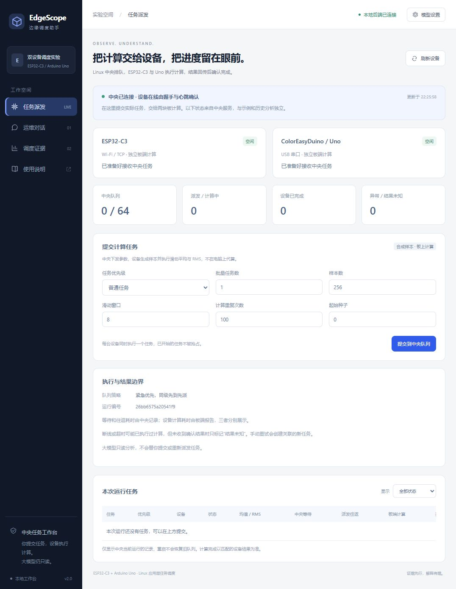

# 第二版双设备计算验收证据

中央派发参数，真实 Uno 与 ESP32-C3 执行滑动平均、均值及 RMS；主机网关不代算。所有样本均为合成数据。

## 实物验收结果

| 项目 | 实测 |
|---|---|
| 接收任务 | 93 |
| 板端成功 | 92（Uno 71，ESP32-C3 21） |
| 结果未知 | 1：主动断开 Uno 网关的任务 28 |
| 手动重试 | 新任务 29 成功，retry_of=28，原记录保留 |
| 队列满 | 无设备时保留 64 项，第 65 项明确 queue_full |
| 数值 | 92 项通过；最大绝对误差 4.687693575533558e-6 |
| 容差 | 1e-4 + 1e-4 × abs(reference) |
| 中央最多同时在途 | 2，每台设备最多 1 |
| 调度 | 审计无违规，3 次紧急任务优先选择，同级 FIFO |

积压阶段任务12～27的派发次序为紧急16、21、26，然后普通12、13、14、15、17……27。固定输入集在仅Uno在线、仅ESP在线时分别运行，含最大count/passes及uint32种子边界。关闭所有网关后，中央保持排队，没有主机代算；恢复真实设备后排空。

`hardware/result.json` 是完整验收结果，`hardware/phases.json` 列出各阶段；`hardware/service/tasks.csv` 和 `events.jsonl` 支持独立核对。使用 `python -m tools.dispatch_verify --service docs/evidence/central-dispatch/hardware/service` 可重算参考和审计。网关各连接的协议记录在相邻 `gateway-*` 目录。验收退出时已归档，`status.json` 的 running=false 和节点断开是正常收尾；实时在线状态应访问当前服务。

Uno71与ESP21包含单设备隔离和重新连接顺序，不是吞吐对照；在途区间重叠不等于同步CPU指令轨迹。故意保留unknown使all_tasks_succeeded=false，这是预期故障语义，完整验收success=true。

## 网页实操

另一个独立运行通过页面提交4项普通、2项紧急任务，6项真实计算全部成功；参考最大误差2.318846540561026e-6，记录见 `web/service` 与 `web/verification.json`。这6项没有紧急插队事件；插队结论仅依据上方93任务验收。

同时检查了中央离线时禁用提交、不显示历史设备在线，执行中筛选，以及390×844窄屏无整页横向溢出。最终新运行两板空闲、0任务，保持供用户提交；截图为各次实测页面，不能代替当前在线状态。

## 编译和回归

普通及ASan/UBSan构建分别176项Python测试通过；固件C/C++的3项CTest通过。补充历史分析路径启动参数后，5项启动器测试通过。JS语法与git diff检查通过。原有回归保留，CI增加新固件编译且继续编译旧固件。

Uno最终固件7754B Flash、631B全局RAM，剩余1417B；ESP32-C3最终固件965903B Flash、37068B全局RAM。两块均真实烧录后验收。`checks/`保留测试及编译日志；`manifest.json`记录源码和本地烧录产物SHA256、FQBN和版本。上传详细日志、完整编译产物及中间失败记录留在用户D盘输出，不提交凭证或网络配置。

实测还发现并修复了一个优先级集成问题：早期固件按“编号必须递增”去重，会误拒绝较早的普通任务。最终改为512编号的64字节会话位图，增加乱序、重复、新旧会话及边界测试，并重新烧录两板跑完整验收。首次失败记录保留，不混入成功结论。
