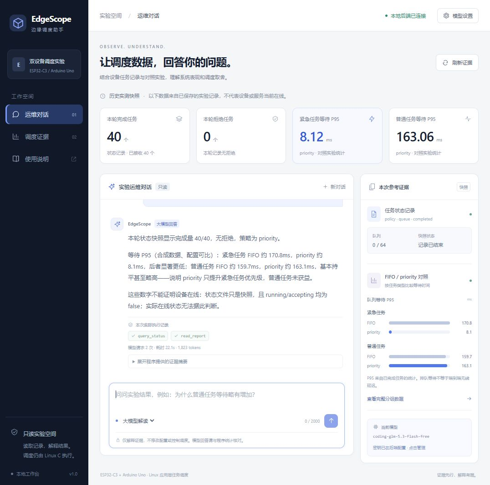

# 本地网页工作台验收

本记录验证新增网页入口，不替代设备上电、无线连通性或实时调度验收。页面默认读取仓库保存的历史状态和对照报告，未重新采集硬件数据。

## 自动回归

在 WSL Ubuntu-24.04 的项目根目录执行 `make test`：C 核心与可移植固件测试通过，124 项 Python 测试全部通过。网页接口占 15 项，使用真实回环 HTTP 服务和模拟模型，不向外部模型发送自动测试请求。`node --check web/app.js` 与 `git diff --check` 通过。

网页接口验证固定静态资源、筛选后的状态、内存密钥配置/清除、无 Key 的规则模式、真实工具闭环的模拟响应、显式失败回退、模型响应凭据验证失败回退、Host/Origin/CSRF 拒绝、JSON 及问题大小限制、深层 JSON 拒绝、并发分析拒绝和任意路径/接口配置拒绝。

## 浏览器实测

在本机 `http://127.0.0.1:8765` 完成以下操作：

- 大模型模式真实请求 `coding-glm-5.3-flash-free`，页面显示“大模型回答”，实际执行 `query_status` 和 `read_report`，2 次模型请求、22.1 秒、返回用量合计 1823 tokens。此用量仅含最终这一题的两次请求，不含此前的一题探测。后台仅在 HTTP 200、工具取证成功且最终未截断时承认正常模型结果。
- 回答引用完成 40、拒绝 0，紧急等待 P95 170.8→8.1ms、普通 159.7→163.1ms，明确状态文件不能证明设备当前在线。数值与右侧程序统计一致；模型的文字解释仍需人工核对。
- 切换离线规则并提问，页面显示“离线规则”、模型请求 0 次，给出程序提供的统计摘要。
- 完整分组数据与聊天视图切换、新对话、刷新证据、设置窗口取消、使用说明均可操作。设置窗口不显示已有密钥。
- 390×844 窄屏下导航可展开并选择页面；侧栏关闭后右边界为 0、文档宽度等于视口宽度，无页面横向溢出。测试后恢复默认窗口尺寸。
- 浏览器采集的 warning/error 控制台记录为空。

`browser-visible.txt` 是最终页面可见文本的记录，不是原始 API 日志。未记录 Key、Authorization、模型思考文本或任意主机文件；页面聊天默认不落盘。

## 使用范围

页面只提供解释与证据查看；没有修改 C 调度策略、启动硬件或执行 shell 的工具。每题独立分析，历史消息不作为后续模型上下文。Key 只留在当前后端内存，重启后需重新输入。本机验收截图不表示网站已发布到公网。
