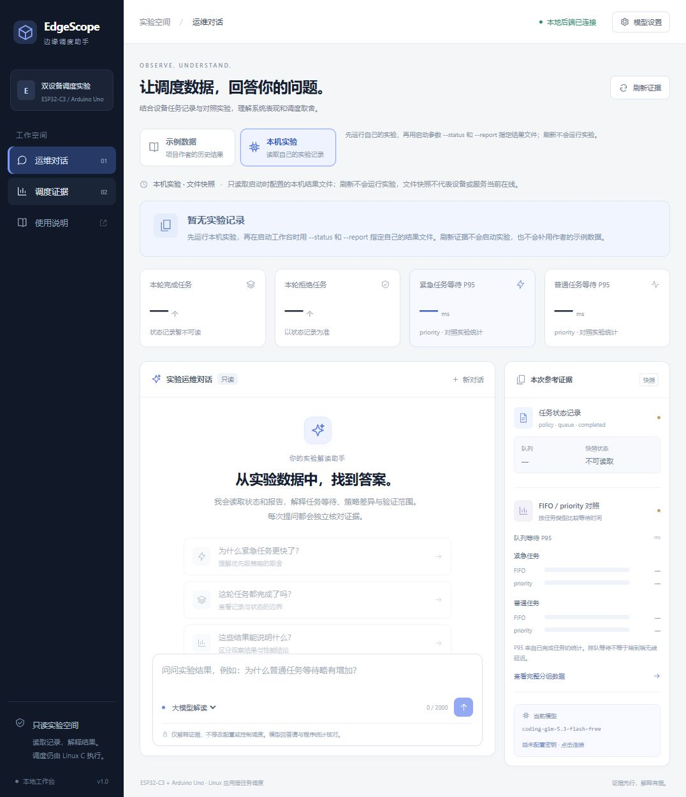
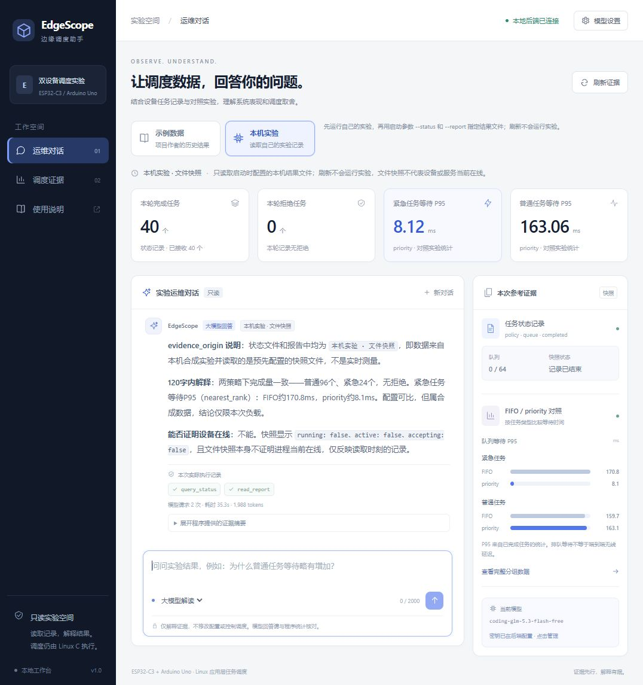

# 示例数据 / 本机实验入口验收

新增入口只改变网页选取证据的方式，没有启动新的硬件采集或调度实验。首次打开固定选择示例数据；浏览器不保存上次选择。两个入口都读取文件快照，不表示设备当前在线。

## 行为与自动回归

- 示例入口读取仓库中的作者历史记录。`--status` / `--report` 只配置本机入口，未配置时分别使用未跟踪的 `results/live/status.json` / `results/comparison/report.json`。
- 状态和聊天请求都明确传递 `source=example|local`。选择是请求级参数，不是服务端共享开关；聊天工具仅收到所选来源的数据及固定来源标签。
- 本机文件不存在或格式无效时，对应字段不可用；两者均不可用时显示“暂无实验记录”，数字为 `—`，聊天在建立模型客户端之前被拒绝。只有一份有效时显示部分记录，绝不从示例补齐。
- 切换入口清空对话、输入和已有指标；读取期间与分析期间禁用入口切换，并用请求序号校验响应，避免旧来源响应覆盖新入口。
- WSL Ubuntu-24.04 执行 `make test`：C 核心、可移植固件及 131 项 Python 回归通过。其中网页 22 项，覆盖缺失/无效/部分本机证据、非法或重复来源、交错请求隔离、所选来源的模型工具数据等。自动回归不访问外部模型。JS 语法检查与差异检查通过。

## 浏览器验证

1. 默认启动并选择本机入口，没有结果文件时出现空状态；完成量、拒绝量、P95、柱形数据均不沿用示例。聊天和推荐问题禁用，完整分组页也显示缺少本机报告。
2. 将本机入口显式指向当前电脑此前生成的 `project-demo-v2/service/status.json` 与 `dual-device-scheduler/comparison/report.json` 后，页面读到完成 40、拒绝 0 及相应 P95。示例入口仍读取独立的仓库文件。此电脑正是示例数据的原始生成电脑，数值相同不表示两个入口混用了文件。
3. 本机入口通过真实模型完成问答，显示“大模型回答 / 本机实验 · 文件快照”。模型调用 query_status、read_report，共 2 次请求、35.3 秒、用量合计 1988 tokens；回答识别了工具中的本机来源标签，并说明不能由快照证明在线。截图保留原始模型措辞，文字仍需核对。
4. 切到示例入口后本机回答清空；离线规则提问显示“示例数据 · 作者历史结果”、模型请求 0 次。
5. 390×844 窄屏下两个入口均可用，文档宽度等于视口宽度，没有横向溢出；验证后恢复默认尺寸。

未运行本机实验时：

本机已有历史记录并实际调用模型：

上述真实模型请求与模拟回归独立进行。密钥仅保存在当前后端进程内存，不写入材料或源码。
