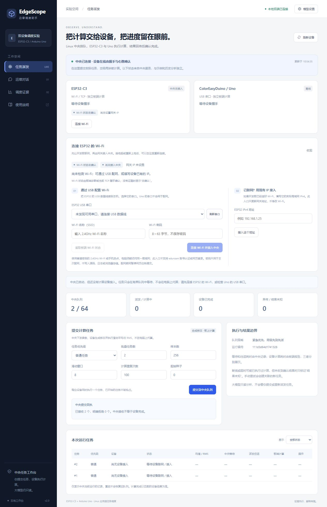
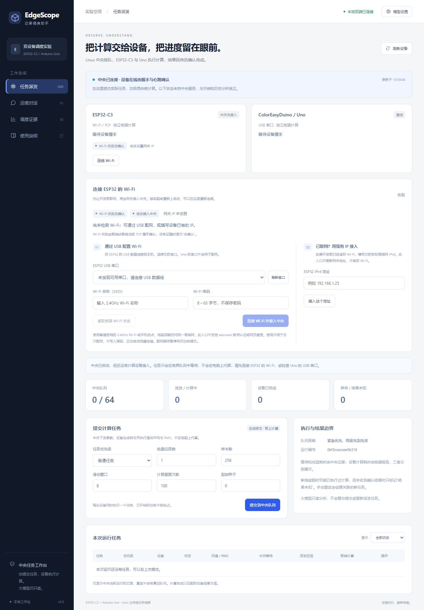

# Wi-Fi 状态与网页连接入口验收

## 行为

ESP32 卡片新增“连接 Wi-Fi”，Wi-Fi 和中央握手分别显示。没有 TCP 握手时，不能据此断定 Wi-Fi 未连接：未经诊断显示“状态未确认”，USB STATUS 可以报告已连接／未连接；超过15秒且无当前TCP证据时，诊断不再冒充实时状态。旧固件可继续CONFIG配网，STATUS不支持时说明升级需求。

面板提供USB串口刷新、只读板端状态查询、SSID/密码配网及已有IP接入。配网成功后使用板端实际IP更新自有ESP网关，中央和Uno继续保留。无设备且已排队时允许配网；ESP有在途任务时阻止切换。配网进行中暂停新的网页提交／重试，错误或超时不代算、不重试任务。

密码使用本机POST与CSRF，输入框立即清空；不写磁盘、日志、浏览器存储或模型工具。端口必须来自枚举，排除已配置Uno和明显蓝牙端口；已有IP入口仅接受局域网IPv4。普通2.4GHz密码Wi-Fi／热点可用，校园网账号认证与网页登录不在此入口支持范围。

## 验证

- 真实WSL Linux完整回归196项通过；ASan/UBSan程序下196项通过；可移植固件CTest3项通过。
- 注入串口／网关的11项管理器测试通过，含成功／失败、旧固件、排队后接入、在途保护、取消，以及失败清理结束前阻止新操作。
- HTTP新旧14项通过，含CSRF、URL禁止携带连接参数、诊断过期、未知状态、异步202及配网期间拒绝任务变更。
- ESP32-C3官方Arduino core3.3.12编译成功：966563B Flash、37068B全局RAM。DIO/40MHz/8MB设置不变。
- 浏览器连接真实中央、无板卡：提交2项后都等待设备，0项成功；USB入口提示没有可用串口，已有IP入口仍可用，错误地址显示明确提示。390×844布局检查无整页横向溢出；浏览器控制台无告警／错误。

本次没有连接ESP32或Uno，未烧录或执行实物配网。成功配网与换IP流程使用注入传输验证；不能将其写成真实无线测试通过。需要精确STATUS状态时请烧录本版ComputeWiFi，再插USB检测。原有双板实测证据仍保留在central-dispatch目录。

## 记录

checks保存最终完整回归与编译日志。ui-check为实际浏览器无设备的已归档中央：startup.last_live_state是停服前2项queued；service中为停服后failed/central_stopped，均没有板卡成功结果。这是正常终止排队记录，不是配网失败。manifest含源码/编译产物SHA256，编译产物保存在用户D盘交付目录，不提交大文件。

